# DuoCode — Processo e decisões (Trabalho 4)

Este documento conta como o DuoCode saiu do Trabalho 3 e chegou à arquitetura MVVM do Trabalho 4: o que mudou, como dividimos os pacotes, o que decidimos, o que tem dentro de cada `UiState` e as dificuldades que tivemos. Todos os prints foram tirados do app rodando no emulador (Android 17, 1080×2400), a partir da versão atual da branch `main`.

**Trio:** André Caires · Gustavo Cáceres · Brenno Soares

Os slides da apresentação estão em [`DuoCode_Documentacao_T4.pdf`](./DuoCode_Documentacao_T4.pdf). O vídeo está em [`docs/video-trabalho4.mp4`](./docs/video-trabalho4.mp4).

**Sumário**

1. [Como estava no Trabalho 3 e o que mudou](#1-como-estava-no-trabalho-3-e-o-que-mudou)
2. [Como dividimos os pacotes](#2-como-dividimos-os-pacotes)
3. [Decisões do trio](#3-decisões-do-trio)
4. [O que tem dentro de cada UiState](#4-o-que-tem-dentro-de-cada-uistate)
5. [O quiz no MVVM](#5-o-quiz-no-mvvm)
6. [Alguma funcionalidade quebrou?](#6-alguma-funcionalidade-quebrou)
7. [Dificuldades e como resolvemos](#7-dificuldades-e-como-resolvemos)

---

## 1. Como estava no Trabalho 3 e o que mudou

**No Trabalho 3** a tela fazia tudo sozinha. O `AppNavigation` criava o banco e guardava as listas em `mutableStateListOf`, cada `@Composable` chamava o DAO dentro de `CoroutineScope(Dispatchers.IO).launch { ... }` e, depois de gravar, a tela chamava `recarregarListas(...)`.

**No Trabalho 4** o app continua fazendo a mesma coisa, mas cada camada ficou com uma responsabilidade:

```
Tela (@Composable)  ->  ViewModel  ->  Repository  ->  DAO  ->  Room
       ^                    |
       └──── uiState ───────┘   (StateFlow que a tela observa)
```

| Parte | Situação | O que mudou |
|---|---|---|
| Chamadas ao DAO nas telas | **saiu** | Não sobrou `dao`, `CoroutineScope` nem `Dispatchers.IO` dentro de um `@Composable`. |
| `recarregarListas(...)` | **saiu** | O `Flow` do Room emite a lista de novo quando a tabela muda. |
| DAOs | evoluiu | `buscarTodos()` agora retorna `Flow<List<...>>` e deixou de ser `suspend`. |
| Telas | evoluiu | Observam o `uiState` e chamam os métodos do ViewModel. |
| Dados de exemplo | evoluiu | Saíram de um `LaunchedEffect` no `AppNavigation` e foram para o `Callback.onOpen` do `AppDatabase`. |
| Repositories | novo | `LinguagemRepository` e `QuestaoRepository` recebem o DAO e repassam as chamadas. |
| ViewModels e UiStates | novo | Um par para Linguagens, um para Questões e um para o quiz. |
| Factories | novo | Entregam os Repositories para cada ViewModel. |

**Lista de Linguagens** — adicionar, fechar o app e abrir de novo, editar e remover, tudo passando pelo ViewModel:

| Adicionando "TypeScript" | Na lista | Depois de fechar e abrir o app |
|---|---|---|
| 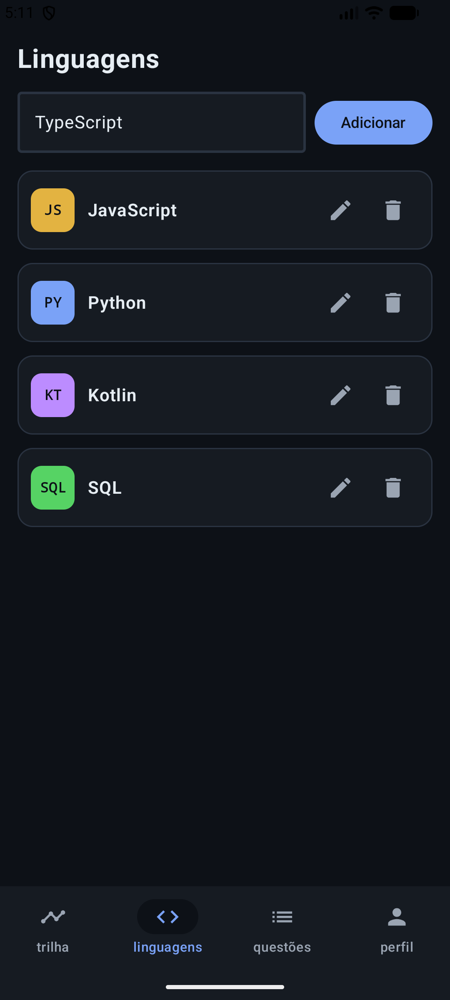 |  | 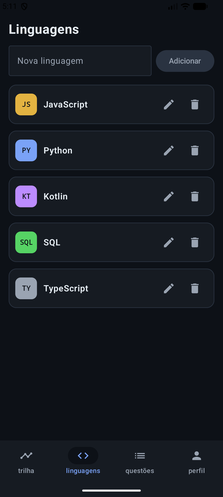 |

| Editando a sigla | Sigla atualizada | Confirmando a remoção | Removida |
|---|---|---|---|
| 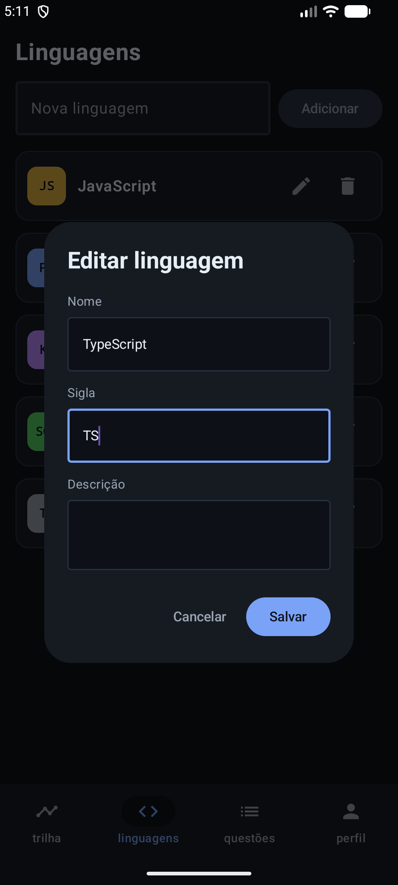 |  | 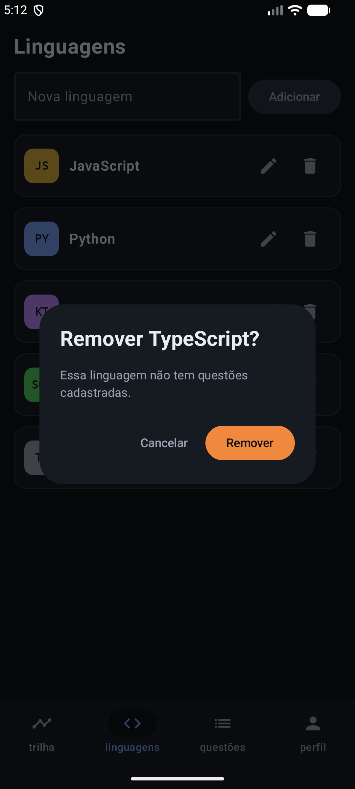 | 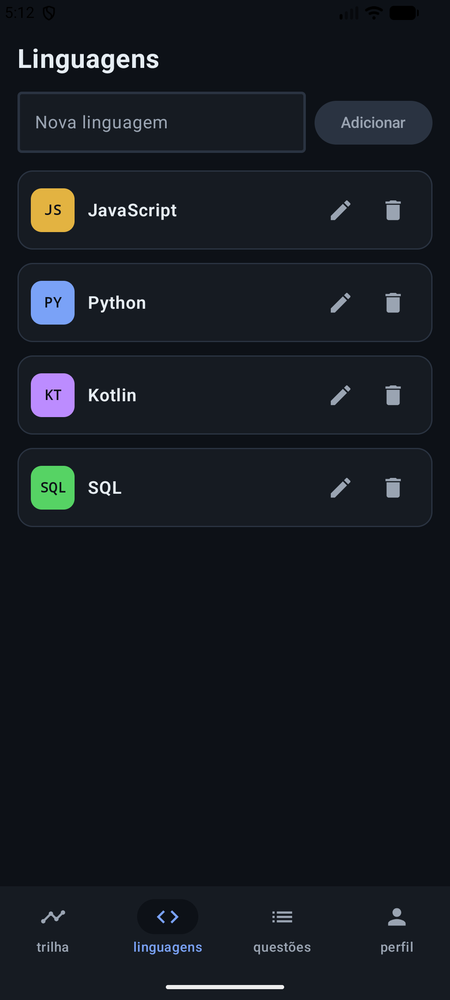 |

**Detalhe da linguagem** — os Detalhes filtram a lista que vem do `Flow`, então o progresso muda sozinho ao marcar uma questão (0/10 → 1/10):

| Aberto pela lista | Marcando uma questão | Criando uma questão |
|---|---|---|
| 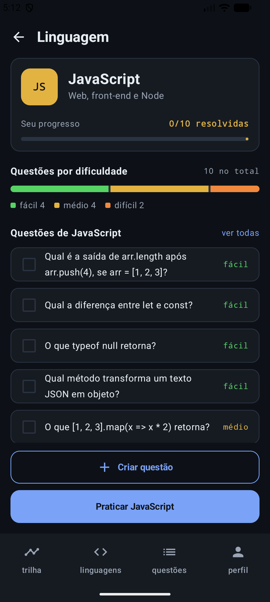 | 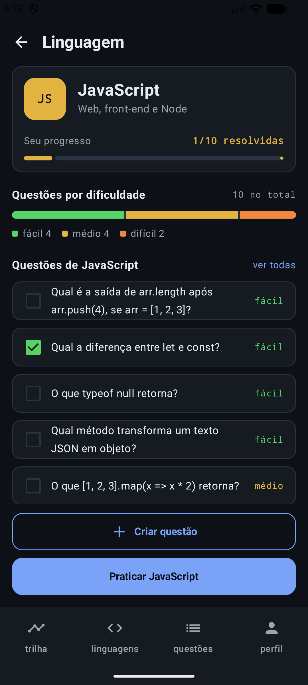 | 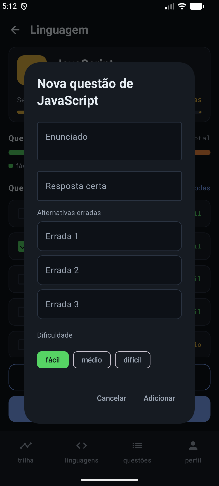 |

**Lista de Questões, Detalhe da questão e Perfil:**

| Questões | Detalhe da questão | Marcada como resolvida | Perfil (dados fixos) |
|---|---|---|---|
| 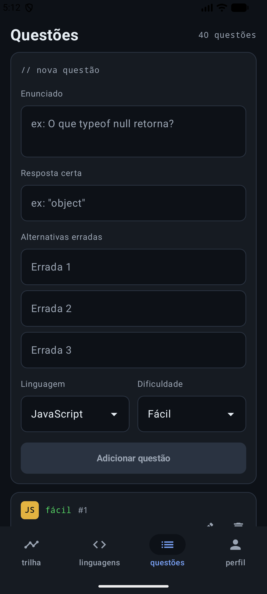 | 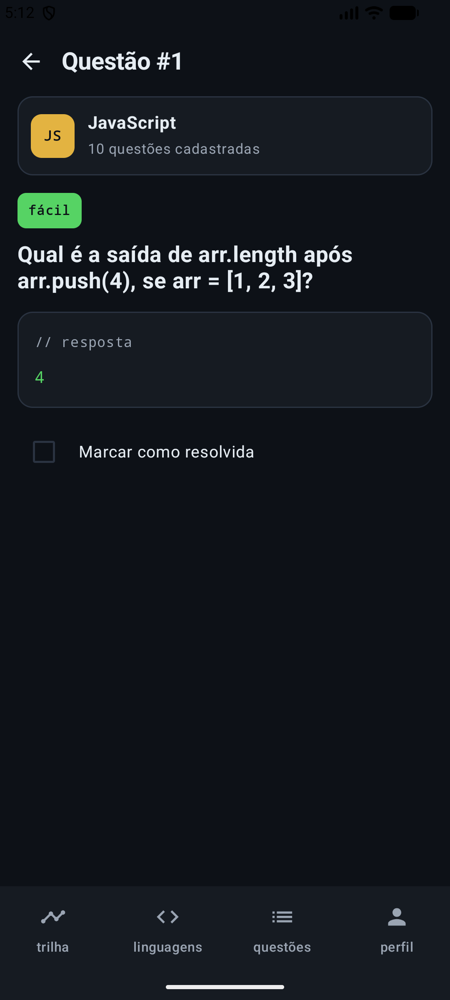 | 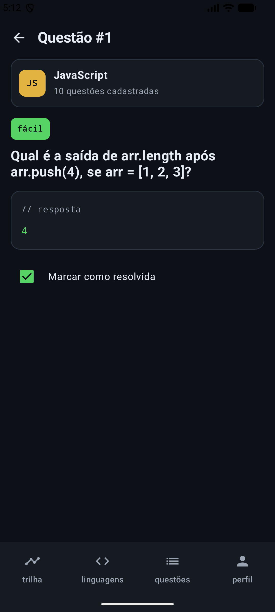 | 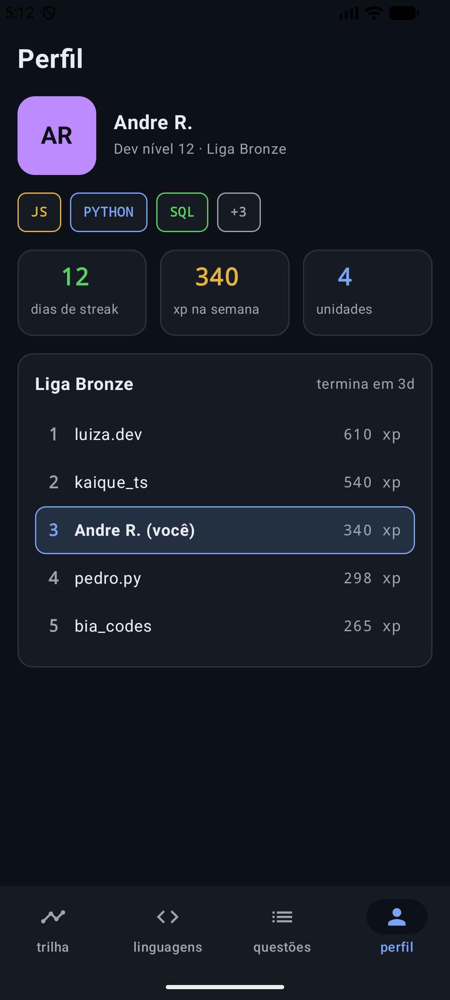 |

---

## 2. Como dividimos os pacotes

```
app/src/main/java/com/example/duocode/
├── MainActivity.kt
├── data/
│   ├── Linguagem.kt, Questao.kt, Dificuldade.kt   ← entidades do Room e o enum
│   ├── LinguagemDao.kt, QuestaoDao.kt             ← queries, com leitura em Flow
│   ├── AppDatabase.kt, Conversores.kt             ← banco em Singleton e TypeConverter
│   ├── DadosIniciais.kt                           ← 4 linguagens e 40 questões de exemplo
│   └── repository/                                ← LinguagemRepository e QuestaoRepository
├── viewmodel/                                     ← UiState + ViewModel + Factory de cada parte
└── ui/
    ├── navigation/                                ← AppNavigation e Rotas
    ├── screens/                                   ← as telas
    └── theme/
```

| Pacote | Responsabilidade |
|---|---|
| `ui` | Desenhar o estado e avisar o ViewModel quando o usuário clica |
| `viewmodel` | Guardar o estado de cada tela e executar as ações |
| `data.repository` | Ser a única porta de entrada para os DAOs |
| `data` | Entidades, DAOs e banco Room |

---

## 3. Decisões do trio

**D1 — Repository entre o ViewModel e o DAO.** Descartamos a tela conhecer o DAO e saber que os dados vêm do Room. Se as questões vierem de uma API, só o Repository muda:

```kotlin
class LinguagemRepository(private val linguagemDao: LinguagemDao) {

    fun getAllLinguagens(): Flow<List<Linguagem>> = linguagemDao.buscarTodos()

    suspend fun buscarPorId(id: Int): Linguagem? = linguagemDao.buscarPorId(id)
```

**D2 — DAO reativo, com `Flow`.** Descartamos chamar `recarregarListas(...)` depois de cada gravação. O Room emite a lista sozinho, e nenhuma tela precisa lembrar de recarregar:

```kotlin
@Query("SELECT * FROM questoes")
fun buscarTodos(): Flow<List<Questao>>
```

**D3 — `UiState` exposto por `StateFlow`.** Descartamos as várias variáveis `remember` espalhadas em cada tela. O `_uiState` é privado e o `uiState` é só leitura, então só o ViewModel altera o estado:

```kotlin
private val _uiState = MutableStateFlow(LinguagensUiState())
val uiState: StateFlow<LinguagensUiState> = _uiState.asStateFlow()

init {
    viewModelScope.launch {
        combine(
            linguagemRepository.getAllLinguagens(),
            questaoRepository.getAllQuestoes()
        ) { linguagens, questoes -> linguagens to questoes }
            .catch { e -> Log.e("LinguagensViewModel", "Erro ao buscar as linguagens", e) }
            .collect { (linguagens, questoes) ->
                _uiState.update { it.copy(linguagens = linguagens, questoes = questoes) }
            }
    }
}
```

**D4 — Um ViewModel só para o quiz.** Descartamos deixar o progresso do quiz dentro da `PerguntaScreen`. O quiz tem estado próprio (perguntas, seleção, acertos) e recebe o `linguagemId` pela Factory.

**D5 — Factory entregando os Repositories, com a tela só observando.** Descartamos a tela pegar o DAO no `AppDatabase` para montar o Repository: quem faz isso agora é o `criar(context)` de cada Repository. A tela recebe o ViewModel como parâmetro com valor padrão:

```kotlin
@Composable
fun LinguagensScreen(
    navController: NavController,
    viewModel: LinguagensViewModel = viewModel(
        factory = LinguagensViewModelFactory(
            LinguagemRepository.criar(LocalContext.current),
            QuestaoRepository.criar(LocalContext.current)
        )
    )
) {
    val uiState by viewModel.uiState.collectAsStateWithLifecycle()
```

**D6 — Entidades em `data` e navegação em `ui`.** Descartamos manter as pastas `model/` e `navigation/`. As entidades do Room são da camada de dados, e a navegação faz parte da interface.

**D7 — Dados de exemplo no `AppDatabase`.** Descartamos inserir por um `LaunchedEffect` no `AppNavigation`. Agora a navegação não conhece mais o banco, e o `onOpen` chama o `inserirDadosIniciais(...)`, que só insere se o banco estiver vazio.

---

## 4. O que tem dentro de cada UiState

**`LinguagensUiState`** (tela de Linguagens):

| Campo | Por quê |
|---|---|
| `linguagens` | A lista que aparece na tela |
| `questoes` | Para o diálogo de remover avisar quantas questões vão junto (CASCADE) |
| `novoNome` | O texto do campo "Nova linguagem" |
| `linguagemEmEdicao` | Qual linguagem está no diálogo de editar (`null` = fechado) |
| `nomeEdicao`, `siglaEdicao`, `descricaoEdicao` | Os textos do diálogo de editar |
| `linguagemParaRemover` | Qual linguagem está no diálogo de confirmar remoção (`null` = fechado) |

**`QuestoesUiState`** (Questões, Detalhe da linguagem e Detalhe da questão):

| Campo | Por quê |
|---|---|
| `linguagens`, `questoes` | Os dados do banco. Os Detalhes filtram a lista pelo `id` |
| `carregando` | Os Detalhes mostram "carregando..." até o banco responder |
| `novaQuestao`, `edicao` | Os rascunhos (`FormularioQuestao`) de criar e de editar |
| `criandoQuestao` | Se o diálogo de criar questão do Detalhe da linguagem está aberto |
| `questaoEmEdicao` | Qual questão está no diálogo de editar (`null` = fechado) |

**`PraticaUiState`** (Pergunta):

| Campo | Por quê |
|---|---|
| `linguagemId` | A linguagem do quiz (`-1` = todas) |
| `linguagens`, `questoes` | Os dados do banco, usados para montar a seleção e as perguntas |
| `desmarcadas` | Os ids das questões que o usuário tirou da prática |
| `perguntas` | As perguntas do quiz (`null` = ainda na seleção) |
| `indiceAtual`, `selecionada`, `respondida`, `acertos` | O progresso do quiz |

Os erros de validação são calculados a partir desses campos. O botão de salvar só fica ativo quando não há erro, como em `erroNovoNome`, `erroEdicao` e `erroNovaQuestao`.

---

## 5. O quiz no MVVM

O `PraticaViewModel` controla o quiz em duas fases: enquanto `perguntas` é `null`, a tela mostra a seleção de questões; depois de `comecar()`, mostra a pergunta atual.

| Trilha | Seleção de questões | Pergunta |
|---|---|---|
| 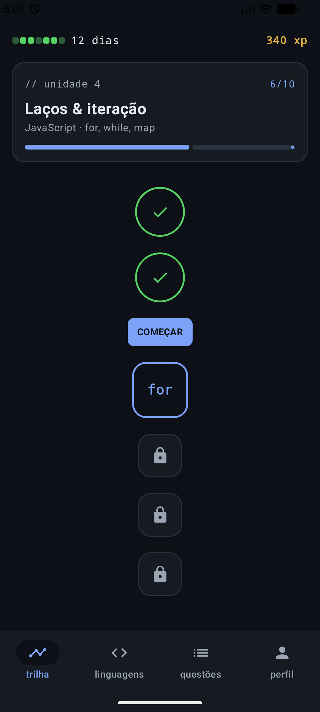 | 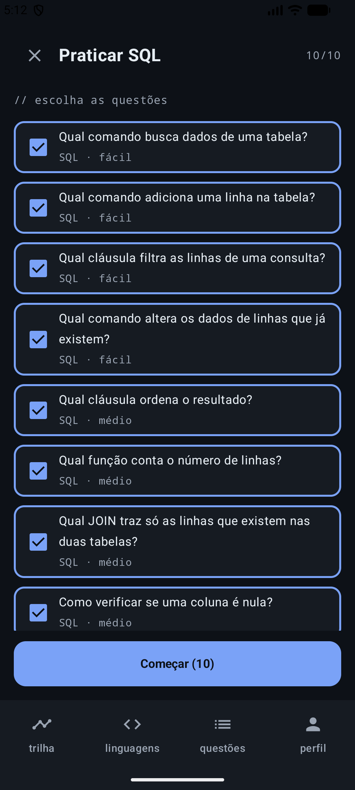 | 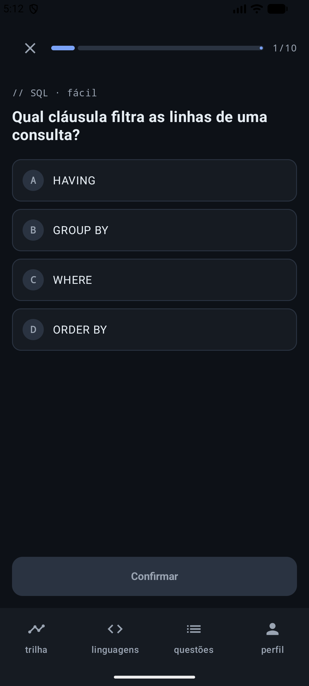 |

| Resposta escolhida | Resposta confirmada | Resultado |
|---|---|---|
| 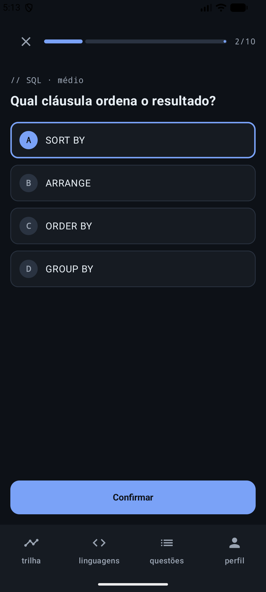 | 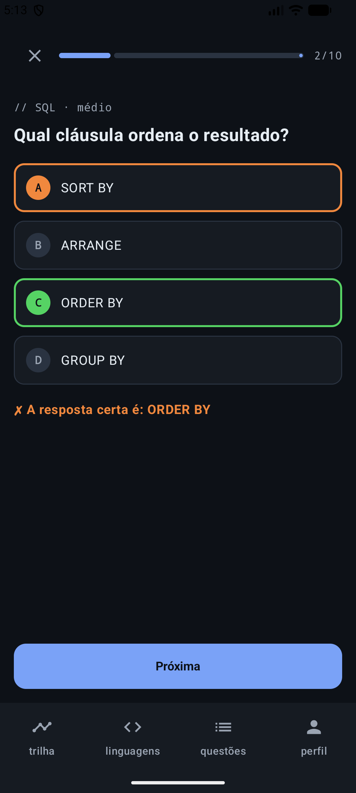 | 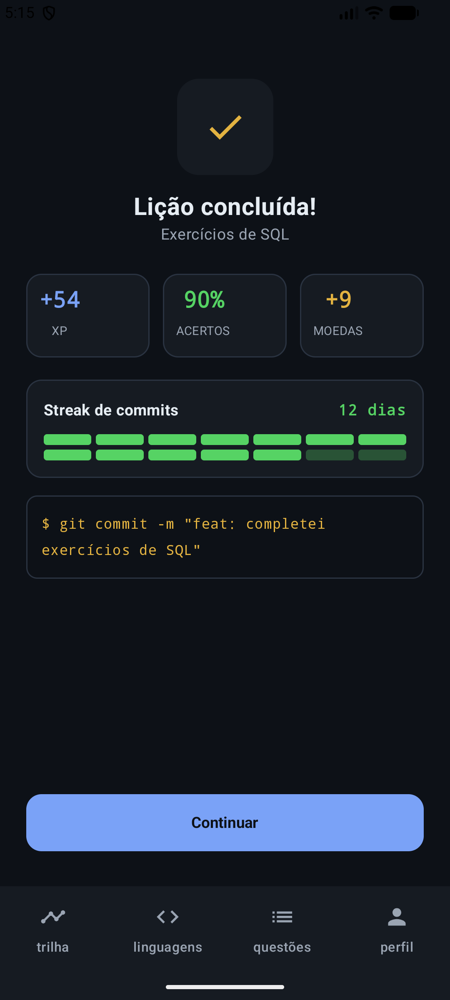 |

O Resultado acima é real: praticamos as 10 questões de SQL, acertamos 9 e erramos 1 de propósito. A tela mostra **90%** de acertos, **+54 XP** (9 acertos × 6) e **+9** moedas, calculados a partir dos números que chegaram pela rota.

- **Confirmar:** trava a resposta e soma o acerto. Se acertou, grava `resolvida = true` no banco.
- **Alternativas:** junta as erradas da questão com respostas de outras questões, tira as repetidas e as iguais à certa, fica com 3 e embaralha com a certa.
- **Resultado:** a tela navega para `resultado/{acertos}/{total}/{linguagens}`, e o nome das linguagens passa por `Uri.encode` porque vai dentro da rota.

```kotlin
val erradas = (questao.alternativasErradas + reservas)
    .map { it.trim() }
    .filter { it.isNotBlank() && !it.equals(correta, ignoreCase = true) }
    .distinctBy { it.lowercase() }
    .take(QUANTIDADE_ALTERNATIVAS_ERRADAS)
val alternativas = (erradas + correta).shuffled()
Pergunta(questao, alternativas, alternativas.indexOf(correta))
```

---

## 6. Alguma funcionalidade quebrou?

Sim, em alguns pontos durante a reorganização, e todos foram corrigidos antes da versão final:

- **O projeto parou de compilar no meio do caminho.** O commit `220c455` apagou `model/Models.kt` e a pasta `navigation/`, mas o `MainActivity` já importava `ui.navigation.AppNavigation`, que ainda não existia. O compilador acusou o erro. O `c339c06` resolveu criando `Linguagem`, `Questao` e `Dificuldade` em `data/` e o `AppNavigation` e o `Rotas` em `ui/navigation/`.
- **Os dados de exemplo pararam de compilar.** Quando o `buscarTodos()` passou a retornar `Flow`, o `DadosIniciais.kt` não podia mais chamar `.isNotEmpty()` nem `.associate { ... }` no resultado. Corrigimos pegando a lista atual com `.first()`.
- **Os dados de exemplo perderam o lugar de onde eram inseridos.** Eles eram inseridos por um `LaunchedEffect` no `AppNavigation`, que deixou de conhecer o banco. Sem outro ponto de inserção, o app abriria vazio. Por isso a chamada foi para o `Callback.onOpen` do `AppDatabase`.

**Como conferimos que nada ficou quebrado:** com o app instalado do zero no emulador, testamos adicionar, listar, editar e remover linguagens e questões, os Detalhes, a remoção em cascata, o quiz até o Resultado e fechar e abrir o app de novo. Tudo funcionou como no Trabalho 3, sem erros no Logcat.

---

## 7. Dificuldades e como resolvemos

**André:** fiz a primeira parte da refatoração (`220c455`), trocando o `buscarTodos()` dos DAOs para `Flow`. A dificuldade foi que o código que usava a lista parou de compilar, como o `DadosIniciais.kt`, porque um `Flow` não é uma lista. Resolvi usando `.first()` para pegar a lista atual e movendo os dados de exemplo para o `Callback.onOpen` do `AppDatabase`.

**Gustavo:** criei os Repositories, os ViewModels com `UiState` e as Factories (`c339c06`) e depois o ViewModel do quiz (`bf91bfc`). A dificuldade foi tirar o estado das telas sem mudar o comportamento, principalmente as validações, que dependiam das listas e dos campos do formulário. Resolvi deixando os erros como campos calculados dentro do `UiState`, como `erroNovoNome` e `erroNovaQuestao`. O quiz tinha estado próprio (perguntas, seleção, acertos), então ganhou um `PraticaViewModel` só para ele.

**Brenno:** conferi o projeto contra o checklist do enunciado. A dificuldade foi que as telas já não chamavam o DAO para ler ou gravar, mas ainda pegavam o DAO para montar o Repository, com `AppDatabase.getDatabase(...).linguagemDao()` dentro do `viewModel(factory = ...)`. Resolvi criando um `criar(context)` em cada Repository, e agora a tela só escreve `LinguagemRepository.criar(LocalContext.current)`, sem citar o banco. Depois repeti todos os testes no emulador para garantir que nada tinha mudado.

**Como o trio trabalhou:** os commits do Trabalho 4 no histórico da `main` são estes:

| Quando | Quem | Commit | O que entrou | Linhas |
|---|---|---|---|---|
| 03/11 · 08:38 | André Caires | `220c455` | Refatora para MVVM: ViewModels, Repositories e DAOs com `Flow` | +222 −568 |
| 03/11 · 11:43 | Gustavo Cáceres | `c339c06` | Cria Repositories, ViewModels com `UiState` e Factories | +816 −226 |
| 03/11 · 11:44 | Gustavo Cáceres | `6b77a28` | Merge do pull request #6 | — |
| 03/11 · 15:46 | Gustavo Cáceres | `bf91bfc` | Cria o ViewModel do quiz com `UiState` e Factory | +236 −116 |
| 03/11 · 15:47 | Gustavo Cáceres | `ee80fe9` | Merge do pull request #7 | — |
| 03/11 · 16:56 | André Caires | `b5174b1` | Atualiza o README com a reorganização em MVVM | +55 −36 |
| 03/11 · 18:09 | Brenno Soares | `35ef28d` | Move a criação dos Repositories para fora das telas, com `criar(context)` | +24 −15 |
| 03/11 · 18:10 | Brenno Soares | `be3f79b` | Documenta o Trabalho 4: README, `PROCESSO.md`, prints e slides | +311 −15 |
| 03/11 · 18:18 | Brenno Soares | `7139614` | Merge da `main` na branch `documentacao-t4` | — |
| 03/11 · 18:19 | Brenno Soares | `69618f7` | Merge do pull request #8 | — |
| 03/11 · 19:04 | Brenno Soares | `a657fdb` | Adiciona o vídeo do Trabalho 4 | +3 −1 |
