# DuoCode - Trabalho 3

App Android de quiz para programadores, no estilo Duolingo, feito em Kotlin com Jetpack Compose.

Neste trabalho o app passou a guardar os dados num banco local com **Room**. As linguagens e as questões que você adiciona, edita ou remove continuam lá mesmo depois de fechar o app.

## Integrantes

- André Caires
- Gustavo Cáceres
- Brenno Soares

## Como rodar

1. Requisitos:
   - Android Studio atualizado (o projeto usa Android Gradle Plugin 9.4 e Gradle 9.6)
   - Android SDK 37 instalado (Tools → SDK Manager)
   - Emulador ou celular com Android 7.0 (API 24) ou superior
2. Clone o repositório:
   ```
   git clone https://github.com/Gustavo-Caceres/Duo_Code_Parte_Tres.git
   ```
3. Abra a pasta `Duo_Code_Parte_Tres` no Android Studio e espere o Gradle Sync terminar. Na primeira vez ele baixa o Room, o KSP e o JDK usado pelo Gradle, então pode demorar alguns minutos.
4. Escolha um emulador (ou conecte um celular com depuração USB ativada) e clique em **Run ▶** (`Shift+F10`).

Na primeira vez que o app abre, o banco é criado com 4 linguagens e 40 questões de exemplo.

### Se o app abrir sem nenhum dado

Se o celular já tinha uma versão antiga do app instalada, o banco antigo é recriado automaticamente (versão 2 com `fallbackToDestructiveMigration`). Se mesmo assim as listas aparecerem vazias, desinstale o app do celular e rode de novo.

## Documentação do processo e das decisões

Os prints e o vídeo estão na pasta `docs/`. A apresentação que usamos em sala está em [`docs/DuoCode_Trabalho3.pdf`](docs/DuoCode_Trabalho3.pdf).

### Teste de persistência

Foi o primeiro teste que fizemos depois de ligar as listas ao banco: adicionar um item, fechar o app de verdade (tirando ele dos apps recentes) e abrir de novo. Se o item continua lá, é porque foi salvo no Room e não só na memória.

| Antes de fechar: linguagem "TypeScript" adicionada | Depois de fechar pelos recentes e abrir de novo |
|---|---|
| 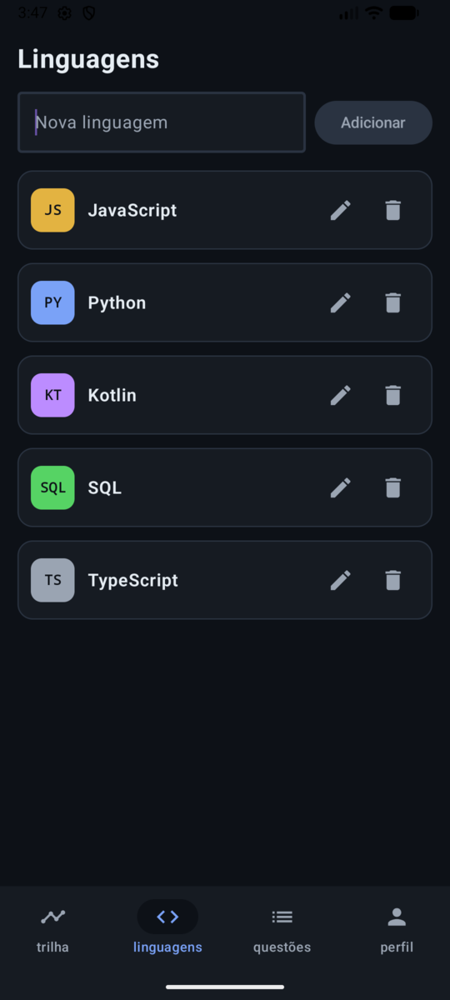 | 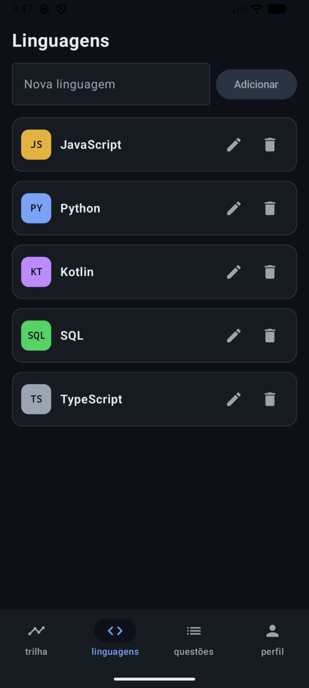 |

No vídeo fizemos o mesmo teste com uma linguagem nova ("cmm") e uma questão dela: adicionamos as duas, fechamos o app, abrimos de novo e a questão apareceu no quiz.

Vídeo: [`docs/teste-persistencia.mp4`](docs/teste-persistencia.mp4)

### Como estava o projeto no Trabalho 2, e o que mudou

No [Trabalho 2](https://github.com/acairesm/Duo_Code_Parte_Dois) o app já tinha as mesmas telas, a navegação e os formulários, mas todos os dados ficavam em memória:

- As linguagens e as questões eram duas listas criadas com `mutableStateListOf(...)` direto no `AppNavigation.kt`, com 4 linguagens e 7 questões escritas no código.
- O `id` de cada item era escrito à mão. Para adicionar um item novo, a tela pegava o maior `id` e somava 1.
- Para remover uma linguagem a gente fazia `linguagens.remove(...)` e depois apagava as questões dela com `questoes.removeAll { ... }`.
- Não tinha edição, só adicionar e remover.
- As telas de Detalhes recebiam a lista inteira e procuravam o item com `find { it.id == id }`.
- As alternativas do quiz estavam fixas dentro da `PerguntaScreen`.

Ou seja, era só fechar o app que tudo voltava ao estado inicial.

No Trabalho 3 fomos fazendo a troca por partes, cada uma numa branch com pull request:

1. **Room e KSP.** Primeiro colocamos o plugin `com.google.devtools.ksp` e sincronizamos, e só depois as dependências `room-runtime`, `room-ktx` e `ksp(room-compiler)`, na ordem que vimos em aula.
2. **Entities.** Aproveitamos as duas data classes que já existiam (`Linguagem` e `Questao`). Cada uma ganhou `@Entity(tableName = ...)` e `@PrimaryKey(autoGenerate = true) val id: Int = 0`.
3. **DAOs e AppDatabase.** Um DAO para cada entidade e o banco em Singleton.
4. **Listas lendo do banco.** As listas fixas saíram do código. Os dados de exemplo agora ficam no `DadosIniciais.kt` e só são inseridos se o banco estiver vazio. Cada tela de lista busca os dados com `LaunchedEffect(Unit)` chamando `buscarTodos()`.
5. **Edição.** Botão de editar e diálogos para linguagem e questão, salvando com `atualizar(...)`.
6. **Detalhes pelo id.** As duas telas de Detalhes recebem só o `id` pela navegação e buscam o item com `buscarPorId(id)`.

#### O app funcionando com o banco

| Linguagens (lidas do banco) | Adicionar questão | Editar linguagem (`atualizar`) |
|---|---|---|
| 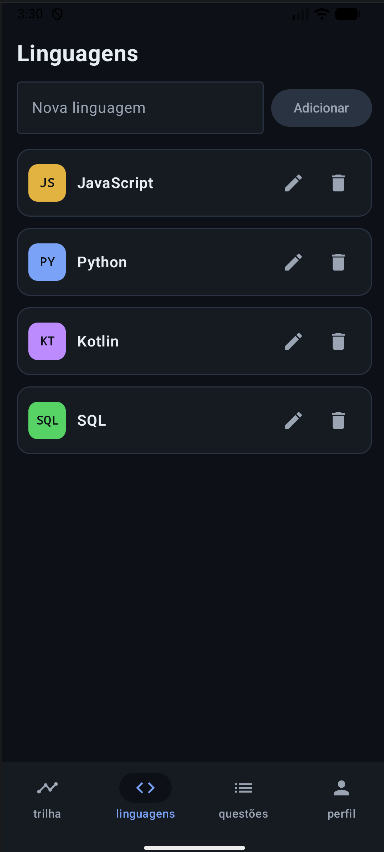 | 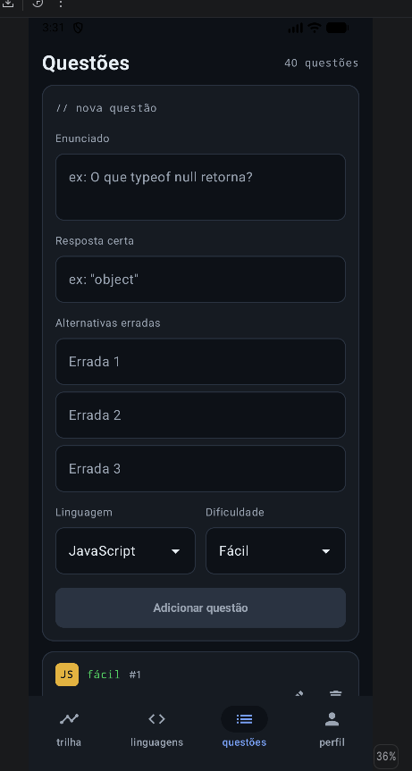 | 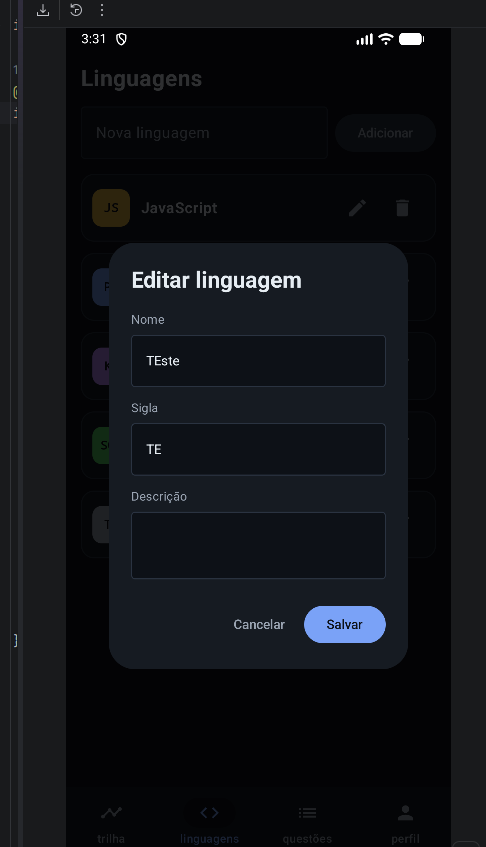 |

| Detalhe da linguagem (`buscarPorId` + `buscarPorLinguagem`) | Detalhe da questão (`buscarPorId`) | Remover (`deletar`) |
|---|---|---|
| 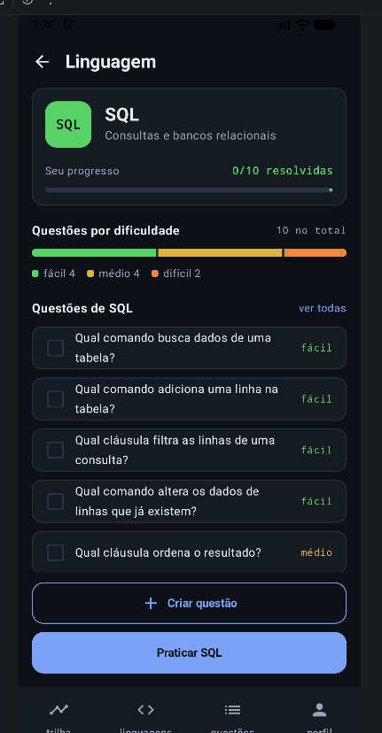 | 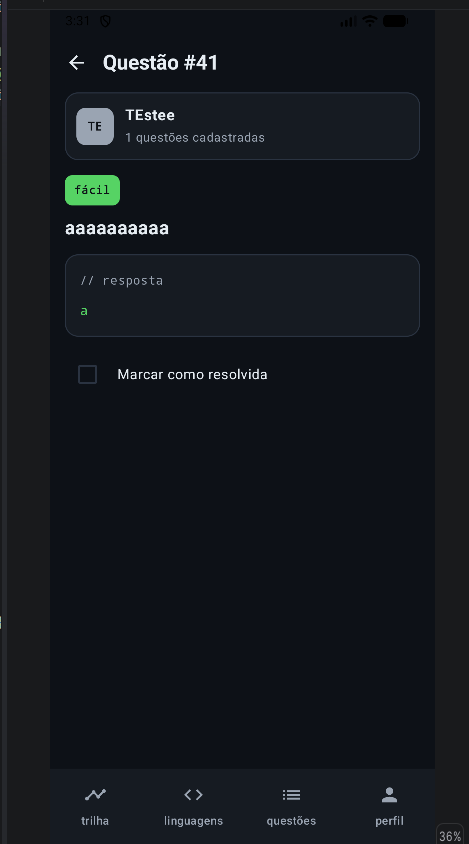 | 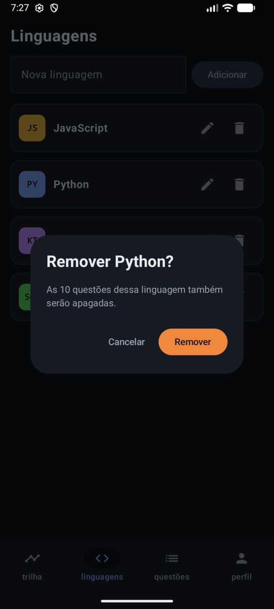 |

| Trilha | Escolher questões para praticar | Quiz com as alternativas do banco | Perfil |
|---|---|---|---|
| 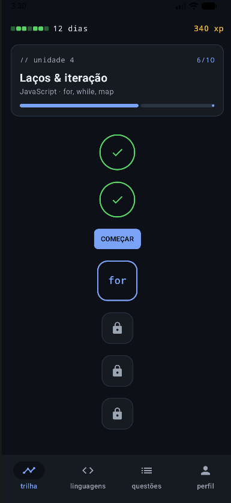 | 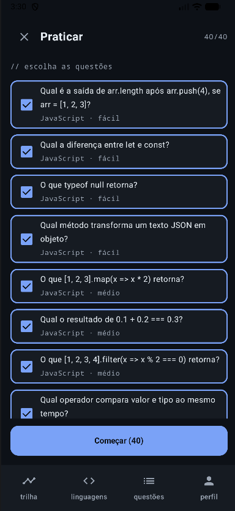 | 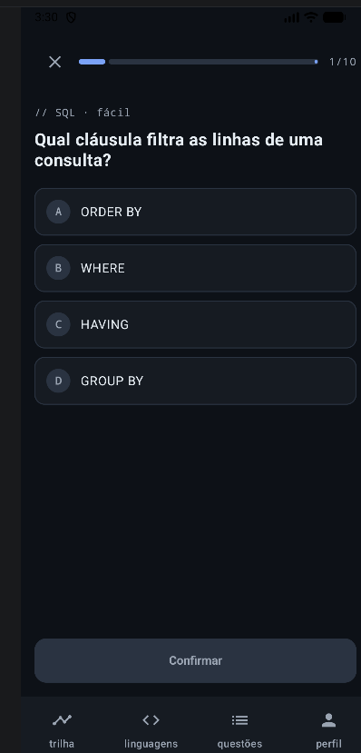 | 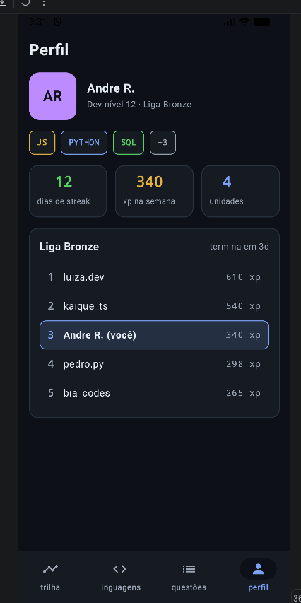 |

Ao remover uma linguagem, o app avisa quantas questões vão junto, porque o banco apaga as questões dela também (CASCADE).

### Entity, DAO e Database criados, e por que esses campos

**`Linguagem`** (tabela `linguagens`): `id`, `nome`, `sigla`, `descricao`.
- `nome` e `sigla` são o que aparece na lista. A sigla vira o "ícone" do card (JS, PY, KT, SQL).
- `descricao` é opcional e aparece no detalhe da linguagem.

**`Questao`** (tabela `questoes`): `id`, `enunciado`, `resposta`, `linguagemId`, `dificuldade`, `resolvida`, `alternativasErradas`.
- `enunciado` e `resposta` são a pergunta e a alternativa certa.
- `linguagemId` liga a questão à linguagem. Virou uma chave estrangeira com `onDelete = CASCADE`, então ao remover uma linguagem o próprio banco apaga as questões dela, sem o `removeAll` que a gente usava no Trabalho 2.
- `dificuldade` (fácil, médio, difícil) aparece como etiqueta no card e no quiz.
- `resolvida` marca se a questão já foi acertada. Agora o progresso fica salvo depois de fechar o app.
- `alternativasErradas` é novo no Trabalho 3. Antes as alternativas do quiz eram fixas no código, agora cada questão guarda as suas. Como o Room não salva `List<String>` direto, criamos um `@TypeConverter` (`Conversores.kt`) que junta a lista num texto só e separa de novo na hora de ler.

**`AppDatabase`**: junta as duas entidades, tem os métodos `linguagemDao()` e `questaoDao()` e segue o padrão Singleton (`companion object` + `@Volatile` + `synchronized`), para o app inteiro usar uma instância só do banco `duocode_database`.

### Como estruturamos as queries do DAO

Os dois DAOs têm os 4 métodos básicos, todos `suspend fun`: `inserir` (`@Insert`), `buscarTodos` (`@Query("SELECT * FROM ...")`), `atualizar` (`@Update`) e `deletar` (`@Delete`).

Além deles, criamos:

| Método | Query | Onde usamos |
|---|---|---|
| `LinguagemDao.buscarPorId(id)` | `SELECT * FROM linguagens WHERE id = :id` | Detalhe da linguagem, e no detalhe da questão para mostrar o nome da linguagem |
| `QuestaoDao.buscarPorId(id)` | `SELECT * FROM questoes WHERE id = :id` | Detalhe da questão |
| `QuestaoDao.buscarPorLinguagem(linguagemId)` | `SELECT * FROM questoes WHERE linguagemId = :linguagemId` | Lista de questões no detalhe da linguagem |

O `buscarPorId` retorna `Linguagem?` / `Questao?`, porque o item pode ter sido apagado. Nesse caso a tela mostra "não encontrada" em vez de fechar o app.

Toda chamada ao DAO fica dentro de `CoroutineScope(Dispatchers.IO).launch { ... }` com `try/catch` e `Log.e(...)`. Depois de inserir, editar ou remover, a tela chama `recarregarListas(...)`, que busca tudo de novo no banco e atualiza as listas no `Dispatchers.Main`, já que o estado da tela tem que ser alterado na thread principal.

### Dificuldades em migrar de `mutableStateListOf` para o Room

- **O `id` deixou de ser nosso.** Com `autoGenerate = true` quem gera o `id` é o banco, então não dava mais para escrever as questões de exemplo com `linguagemId = 1`. Resolvemos inserindo as linguagens primeiro, buscando de volta e montando um mapa `sigla → id`, que as questões usam.
- **Os dados de exemplo não podiam duplicar.** Se o seed rodasse toda vez que o app abre, as linguagens iam aparecer repetidas. Por isso o `inserirDadosIniciais` começa com `if (linguagemDao.buscarTodos().isNotEmpty()) return`.
- **Mudar uma Entity quebrou o banco que já existia.** Quando a `Questao` ganhou o campo `alternativasErradas`, o app abria com as listas vazias no celular que já tinha o banco antigo. No Logcat aparecia o `Log.e` do `AppNavigation` com o erro do Room:

  ```
  Room cannot verify the data integrity. Looks like you've changed schema but forgot to update the version number.
  ```

  Primeiro tentamos uma `Migration(1, 2)` com `ALTER TABLE`, depois voltamos para a versão 1 enquanto o modelo ainda estava mudando, e no fim ficou a **versão 2** com `fallbackToDestructiveMigration(true)`, que recria o banco quando a versão muda. Como os dados são só de exemplo, perder o banco antigo não é problema.
- **As listas não atualizavam sozinhas.** Antes, `linguagens.add(...)` já mudava a tela na hora. Com o banco, inserir no Room não mexe na lista da tela, então toda operação termina com `recarregarListas(...)`.
- **Detalhes sem o objeto pronto.** Como os Detalhes passaram a buscar o item pelo `id`, a tela precisa esperar o banco responder e tratar o caso do item não existir. Colocamos um estado `carregando` e a mensagem de "não encontrada".

### Dificuldades de cada integrante

**Gustavo:** fiquei com a configuração do Room e do KSP, as entidades, os DAOs, o `AppDatabase` e as listas lendo do banco. A primeira dificuldade foi o seed: como o banco gera o id, eu não sabia qual id cada linguagem ia receber para ligar as questões. Resolvi inserindo as linguagens, buscando de volta e montando o mapa `sigla → id`. Depois, quando a `Questao` mudou, as listas começaram a vir vazias. Pelo Logcat vi que era a versão do banco, e subi para a versão 2 com `fallbackToDestructiveMigration`.

**André:** fiz a edição (`atualizar`) de linguagens e questões, as alternativas erradas e o seed com as 40 questões. Minha dificuldade foi que o Room não salva `List<String>` direto, e cada questão precisava guardar as suas alternativas erradas. Resolvi criando o `Conversores.kt` com `@TypeConverter`, que transforma a lista em texto para salvar e volta para lista na leitura.

**Brenno:** fiz as telas de Detalhes buscarem a linguagem e a questão direto no banco pelo `id`. A dificuldade foi que a tela não recebe mais o objeto pronto: ela abre antes do banco responder, e o item pode nem existir mais. Resolvi com um estado de carregando e tratando o retorno nulo do `buscarPorId`.

## Telas

O app tem 8 telas, todas navegáveis pelo `NavHost` em `AppNavigation.kt`:

| Tela | Rota | O que faz com o banco |
|---|---|---|
| Trilha | `trilha` | Abre o quiz com questões de todas as linguagens |
| Linguagens | `linguagens` | Lista, adiciona, edita e remove linguagens |
| Questões | `questoes` | Lista, adiciona, edita e remove questões |
| Perfil | `perfil` | - |
| Detalhe da linguagem | `detalhe_linguagem/{id}` | Busca a linguagem e as questões dela pelo id; marca questões como resolvidas e cria questões |
| Detalhe da questão | `detalhe_questao/{id}` | Busca a questão e a linguagem dela pelo id; marca como resolvida |
| Pergunta (quiz) | `pergunta/{linguagemId}` | Monta o quiz com as questões do banco e marca as acertadas como resolvidas |
| Resultado | `resultado/{acertos}/{total}/{linguagens}` | Mostra acertos e XP da lição |

A navegação principal (Trilha, Linguagens, Questões, Perfil) fica num `BottomNavigation`.

## Estrutura do projeto

```
app/src/main/java/com/example/duocode/
├── MainActivity.kt
├── data/
│   ├── AppDatabase.kt
│   ├── Conversores.kt
│   ├── DadosIniciais.kt
│   ├── LinguagemDao.kt
│   └── QuestaoDao.kt
├── model/Models.kt
├── navigation/
│   ├── AppNavigation.kt
│   └── Rotas.kt
└── ui/
    ├── screens/
    └── theme/
```

## Tecnologias

- Kotlin 2.2.10
- Jetpack Compose (BOM 2026.02.01) com Material 3
- Navigation Compose 2.10.0
- Room 2.8.5 com KSP 2.3.12
- minSdk 24 · targetSdk/compileSdk 37
